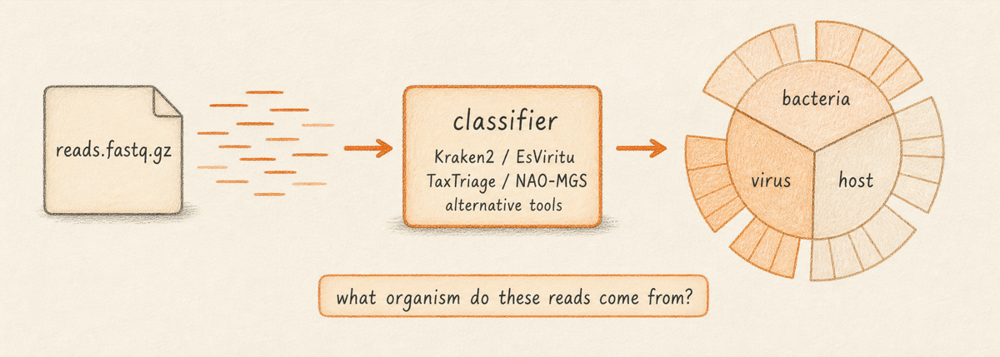

## What it is

[Read classification](../../GLOSSARY.md#read-classification) answers one practical question about a sequencing run, which is what organisms the sample contained. A [read](../../GLOSSARY.md#read) is the record a sequencer writes for one DNA [fragment](../../GLOSSARY.md#fragment), with its bases and a quality for each, stored as one record in a [FASTQ](../../GLOSSARY.md#fastq) file. A classifier is a program that compares each read against a reference database of known genomes and writes down which organism it best matches. The database is a folder of files installed on your own Mac, not a website the app queries. Classify every read in the file and you have a count of which organisms are present.

The answer for a single read is a [taxon](../../GLOSSARY.md#taxon), which is any named group on the tree of life. *Homo sapiens* is a taxon, and so are the primate family Hominidae and the virus family *Coronaviridae*. Every taxon sits at a [taxonomic rank](../../GLOSSARY.md#taxonomic-rank), the level of the naming hierarchy it belongs to. The ranks these tools report run from broadest to narrowest as domain, kingdom, phylum, class, order, family, genus, and species, so for a person the ladder reads Eukaryota, Metazoa, Chordata, Mammalia, Primates, Hominidae, *Homo*, *Homo sapiens*.

A classifier does not always reach species, and a call that stops at genus is still a usable answer. When a read's sequence is shared by several close relatives, the classifier steps back up the hierarchy and reports the [lowest common ancestor](../../GLOSSARY.md#lowest-common-ancestor), the most specific taxon that all the matching organisms belong to. In a database that holds both genomes, a read that fits the rhesus macaque and the cynomolgus macaque equally well is reported as the genus *Macaca* rather than guessed at species. The tool picks that level from what the database contains, and you do not set it yourself.

This is a different question from [mapping](../../GLOSSARY.md#mapping). Mapping starts from an organism you already named and asks where on its genome each read fits. Classification starts from nothing and asks which organism each read came from. A common working pattern is to classify first to find out what is present, then [map the reads](../04-alignments/01-mapping-reads-to-a-reference.md) against whichever genome the classification named.

The whole-sample answer is a distribution rather than a yes or no. It reports what share of the reads went to each taxon, plus a separate share of [unclassified reads](../../GLOSSARY.md#unclassified-reads), the ones the classifier could not name at any rank. This is [metagenomics](../../GLOSSARY.md#metagenomics), the study of all the nucleic acid in a mixed sample at once. Lungfish Genome Explorer (LGE) offers several classifiers. Kraken 2 is the broad survey, EsViritu looks only for viruses, and 12S Amplicon Matching names vertebrate species from one short gene. [The tools](#the-tools) introduces each of them and the rest. They answer different questions, so the one decision to make before you run anything is which question you are asking.

### Counts, shares, and normalized figures

Every result in this part reports how much of an organism it found, and three kinds of number do that job. The glossary entry [abundance](../../GLOSSARY.md#abundance) collects them.

A read count is the evidence. It is the number of reads, read pairs, or alignments assigned to a taxon, such as the Reads column of a Kraken 2 table. A [read pair](../../GLOSSARY.md#read-pair) is the two reads from the two ends of one fragment, and an [alignment](../../GLOSSARY.md#alignment) is one place where a read fits a genome. A count grows with the size of the run, its total number of reads, so 2,000 reads means something different in a run of one million reads than in a run of fifty million.

A [relative abundance](../../GLOSSARY.md#relative-abundance) is a share of a stated denominator, such as the percentage of all reads, of classified reads only, or of one virus's reads. Two shares can be compared only when their denominators match, and the tools in this part use different ones. Kraken 2's percentage counts unclassified reads in its denominator, while the 12S table leaves unmatched reads out of its own.

A normalized abundance divides the count by the [library](../../GLOSSARY.md#library) size, the total number of reads that came from the prepared DNA loaded onto the sequencer, so samples from runs of different sizes can sit side by side. Reads per million ([RPM](../../GLOSSARY.md#reads-per-million)) and reads per billion ([RPB](../../GLOSSARY.md#reads-per-billion)) divide by library size alone, and EsViritu's reads per kilobase of reference per million filtered reads ([RPKMF](../../GLOSSARY.md#rpkmf)) also divides by genome length, where filtered means the reads that survived quality filtering. Compare samples on the normalized figure of one tool, and use the count to judge how much evidence sits behind it. [Comparing the result views](#comparing-the-result-views) names each view's denominator.

## Why you would do this

You classify when you cannot fully predict what is in the tube. A clinical swab from a person or a macaque is the clearest case. A nasal or throat swab often yields mostly the genome of the host, the person or animal sampled, because sampling collects far more host cells than microbes, and whatever pathogen you are chasing sits somewhere in the remainder. Classification answers three questions at once:

1. How much of the run went to host background?
2. Does one bacterium dominate the rest?
3. Is the virus you suspected present at all?

A targeted assay, meaning a test that looks only for organisms chosen in advance, answers only the third.

The same reasoning covers wastewater, a culture you suspect is contaminated, and any library you need to check. [Host depletion](../../GLOSSARY.md#host-depletion), the removal of the sampled organism's own reads, does not have to come first, because [Decontamination](../03-reads/05-decontamination.md) writes a new copy and leaves the original untouched. Classify the original to learn the host share, and deplete a copy before mapping or sharing, though LGE ships a host index for human only.

## Choosing a tool

First check the platform, the read length, whether reads are single or paired, and whether the library is shotgun or amplicon. [Know your reads before you choose a tool](../01-foundations/02-sequencing-reads.md#know-your-reads-before-you-choose-a-tool) explains each, and [Quality Control for Reads](../03-reads/03-quality-control.md#where-lge-shows-the-facts-about-your-reads) lists where LGE shows them, in the [Inspector](../../GLOSSARY.md#inspector), the panel on the right of the window, and on the summary cards. A [shotgun](../../GLOSSARY.md#shotgun) library samples whatever DNA the sample holds, and an [amplicon](../../GLOSSARY.md#amplicon) library copies one chosen stretch of DNA many times with [PCR](../../GLOSSARY.md#pcr), the polymerase chain reaction, before sequencing. Then ask three questions in order, about the sample, the organism you expect, and the library. For a single known organism, such as a person's whole-genome library, classification is only a contamination check, and one Kraken 2 run answers it.

<!-- ILLUSTRATION: classifier-decision-flowchart -->

### Three ways to match a read

Every classifier here matches reads in one of three ways. The first is exact word lookup. Kraken 2 cuts each read into [k-mers](../../GLOSSARY.md#k-mer), overlapping words of exactly k bases, and looks each word up in a prebuilt table that records which taxon owns it. Words of five bases from the read `ACGTTGCA` are `ACGTT`, `CGTTG`, `GTTGC`, and `TTGCA`. Real words are 35 bases long, and the table stores [minimizers](../../GLOSSARY.md#minimizer), the 31-base stretch inside each word that sorts first, so neighboring words often share an entry and the table stays small. Kraken 2 names the read for the best-scoring branch of the taxonomy, as [Running Kraken 2](02-running-kraken2.md#what-it-is) explains. It is fast because nothing is aligned. A word is a hit, a successful lookup, only when its minimizer is in the database, so in simplified terms a read needs a stretch of about 31 matching bases to hit. A virus that differs from every database genome so often that few reads hold such a stretch therefore leaves many reads unclassified.

The second is read mapping. EsViritu, and TaxTriage in its mapping step, line each read up against whole reference genomes with [minimap2](../../GLOSSARY.md#minimap2), a program that aligns reads to genomes while allowing mismatches. TaxTriage's mapping step follows its Kraken 2 step. Mapping is slower but gives [coverage breadth](../../GLOSSARY.md#coverage-breadth), the share of a genome the reads reached. A hundred reads spread along a whole viral genome support the virus's presence, and a hundred stacked on one conserved gene do not, though Kraken 2 counts both the same.

The third is lineage [demixing](../../GLOSSARY.md#demixing), which is what Freyja does. It starts from reads mapped to one virus. At each position that defines a lineage, it measures the [allele frequency](../../GLOSSARY.md#allele-frequency), the share of reads at that position that carry a base differing from the reference. It then estimates the blend of lineages that best explains those shares.

12S Amplicon Matching sits beside these three. It asks whether a read contains a whole known reference sequence, base for base, which is a stricter form of the first way.

### Sensitivity, precision, and the database

Raising [sensitivity](../../GLOSSARY.md#sensitivity), the share of the organisms truly present that a tool finds, usually lowers [precision](../../GLOSSARY.md#precision), the share of its reported names that are correct, as the **Sensitive** and **Precise** presets of Kraken 2's **Sensitivity** setting show in [Settings](02-running-kraken2.md#settings).

The database matters more than any setting. A read from an organism the database lacks is not simply left out. It can be named as the nearest relative the database holds, and host reads are the usual case. The Kraken authors' own protocol paper, [Lu et al. 2022, Metagenome analysis using the Kraken software suite](https://doi.org/10.1038/s41596-022-00738-y), *Nature Protocols* 17, 2815, therefore recommends a database that holds at least the human genome. Kraken 2's [Confidence](../../GLOSSARY.md#confidence-kraken-2) setting is the share of a read's words that must point to a taxon or the taxa below it, 0.20 by default. Kraken 2 also loads its whole database into memory.

The table below gives LGE's memory estimate for five of the database builds. The **Databases** tab of the Plugin Manager, the window that installs tools and databases, lists the others, as [The Databases tab](../01-foundations/07-plugin-packs.md#the-databases-tab) describes.

| Database | Memory | Use it for |
|---|---|---|
| Viral | about 0.5 GB | A virus, even on a Mac with 16 GB |
| Standard-8, Standard-16 | 8 GB, 16 GB | A broad survey on a Mac with that much memory |
| Standard, PlusPF | more than 16 GB | A broad survey, with **Memory mapping** reading the database from disk, and PlusPF adds fungi and protozoa |

The capped builds, Standard-8 and Standard-16, keep only a sample of the full Standard collection's words to fit in 8 GB and 16 GB, so they recognize fewer reads of every organism. On the corneal sample, Standard-16 found about a tenth as many HSV-1 reads as the [Viral database did](02-running-kraken2.md#the-same-reads-a-different-database).

### The tools

**Kraken 2 with Bracken** is the broad survey. Its Standard database covers archaea, bacteria, viruses, plasmids, and the human genome, and fungi and protozoa need the PlusPF builds. Every run started from the Kraken2 dialog also requests [Bracken](../../GLOSSARY.md#bracken), which divides the reads Kraken 2 left at genus or family among the species below and shows its estimates in a separate column beside Kraken 2's counts, and the dialog has no switch to turn it off. It is the broadest tool here and the weakest on a virus that differs from every genome in its database.

**EsViritu** is the viral specialist. It maps reads against 19,925 curated viral genomes and reports reads, breadth of coverage, [depth](../../GLOSSARY.md#depth) of coverage, meaning how many reads cover each base, and a [consensus sequence](../../GLOSSARY.md#consensus-sequence), the sequence the mapped reads agree on, for each virus. It was built for short-read Illumina data and finds only viruses. It keeps a read only when at least 100 of its bases align, so reads of 100 bases or more can count and shorter reads never do, a cutoff built into EsViritu itself.

**TaxTriage** is the scored report. It runs Kraken 2, downloads a reference genome from NCBI for each top hit, which needs an internet connection, maps the reads to them, and folds breadth and depth into one [TASS score](../../GLOSSARY.md#tass-score) per organism. The score runs from 0, not confident at all, to 1, as confident as the score gets, and it weighs how well the evidence hangs together, not how many reads there are. It was built for clinical batches with a [negative control](../../GLOSSARY.md#negative-control), a blank tube carried through the whole protocol, and without one it cannot flag reagent contamination. It maps only the organisms Kraken 2 names most often, so it cannot test one that Kraken 2's database lacks. It is the slowest route, and it runs its steps in [containers](../../GLOSSARY.md#container), packaged copies of each program and everything it needs, through [Docker Desktop](../../GLOSSARY.md#docker), a separate application you install yourself, as [Tools that run in containers](../01-foundations/07-plugin-packs.md#tools-that-run-in-containers) explains.

**12S Amplicon Matching** names the vertebrate species in a mixed sample from a short PCR-copied stretch of the mitochondrial [12S](../../GLOSSARY.md#twelve-s) gene. It counts each DNA fragment once, whether the sequencer read it once or from both ends, and only when it contains a whole known reference sequence from a list you build yourself, so a species missing from your list can never appear. Kraken 2 cannot answer this, because the only vertebrate in its Standard database is human.

**Freyja** estimates which SARS-CoV-2 [lineages](../../GLOSSARY.md#lineage), the named subgroups of one virus species, are mixed in a sample. LGE runs it only from `lungfish-cli`, its command-line interface (CLI), which you use by typing commands in [Terminal](../../GLOSSARY.md#terminal), the macOS app in the Utilities folder, as [Running Freyja](07-running-freyja.md) shows. Its lineage barcodes, the tables of mutations that mark each SARS-CoV-2 lineage, download when you install its experimental [plugin pack](../../GLOSSARY.md#plugin-pack), a set of tools LGE adds on request. Experimental means a result needs a second check before it goes into a report. For one patient's SARS-CoV-2 genome use [The Viral Recon Wizard](../04-alignments/05-viral-recon-wizard.md) instead.

Three routes are imports only, so you ask the group that runs each one for its output, a [taxon report](../../GLOSSARY.md#taxon-report) from CZ ID, `virus_hits_final.tsv.gz` from NAO-MGS, or a `*_blast_concatenated.csv` file from NVD. **CZ ID** is a hosted web service you use in a browser that searches reads against the nucleotide collection of [NCBI](../../GLOSSARY.md#ncbi), the United States National Center for Biotechnology Information, and, separately, against its protein collection. The protein search can catch a virus too different from known genomes for word lookup, but LGE's import carries only the nucleotide counts into its viewport, the panel in the middle of the window that shows a result, as [Importing CZ ID Results](08-importing-cz-id-results.md#what-the-conversion-keeps) explains. **NAO-MGS** is SecureBio's pipeline for wastewater surveillance, run on a computing cluster or in the cloud, reporting every read that matched a viral genome. **NVD** is the O'Connor laboratory's pipeline, usually run on a computing cluster, that assembles reads into [contigs](../../GLOSSARY.md#contig), long stretches built from overlapping reads, and searches each contig with [BLAST](../../GLOSSARY.md#blast), NCBI's sequence search, which suits hunting a virus no database names exactly.

| Tool | Choose it when | Use something else when |
|---|---|---|
| Kraken 2 with Bracken | You have no hypothesis, you are checking a library, or you suspect a bacterium and need no score | You need coverage evidence for a virus call, so add EsViritu or TaxTriage |
| EsViritu | You suspect a virus, your reads are 100 bases or more, and you want to show how much of its genome you recovered | Reads are under 100 bases or the target may be a bacterium, so use Kraken 2 or TaxTriage |
| TaxTriage | Each call must carry a score a reviewer can check, bacteria included | You cannot install Docker Desktop or a quick look will do, so use Kraken 2 |
| 12S Amplicon Matching | You need a species list from a 12S amplicon run | The library is shotgun, so use Kraken 2, or your species are missing from your reference, so add them |
| Freyja | The sample is known SARS-CoV-2 and may hold several lineages | You have one patient's genome, so use the Viral Recon Wizard |
| CZ ID (import) | A colleague already ran the sample there | You need per-read evidence, BLAST checks, or read extraction, so run Kraken 2 |
| NAO-MGS (import) | A surveillance team hands you its virus-hit table | You need anything other than viruses, so run Kraken 2 |
| NVD (import) | You are hunting a virus that matches known ones only partly | You need a census of the whole sample, so run Kraken 2 |

Three situations need a different route:

| Your situation | Run this |
|---|---|
| Wastewater reads of your own | [Running Freyja](07-running-freyja.md) for a SARS-CoV-2 lineage mix, or [Running EsViritu](03-running-esviritu.md) for other viruses when reads are 100 bases or more. LGE cannot run NAO-MGS or NVD, so import their results. |
| A suspected virus in reads under 100 bases | Kraken 2 with the Viral database, as the 76-base corneal reads show in [Running Kraken 2](02-running-kraken2.md), then [Running TaxTriage](04-running-taxtriage.md) for coverage evidence, then [BLAST Verification](06-blast-verification.md). EsViritu would find nothing. |
| Oxford Nanopore reads | TaxTriage and 12S Amplicon Matching have a nanopore setting. Kraken 2 has no platform setting, and LGE runs EsViritu only with its short-read setting. |

### What this part's examples use

The examples use public runs from the NCBI Sequence Read Archive. Each run has an [accession](../../GLOSSARY.md#accession), the permanent identifier the archive gives one public sequencing run. A [paired-end](../../GLOSSARY.md#paired-end) run reads each fragment from both ends, giving two [mates](../../GLOSSARY.md#mate), and LGE stores both mates of a sample in one [bundle](../../GLOSSARY.md#bundle), a folder that LGE treats as one item.

The Kraken 2, TaxTriage, and BLAST chapters use human corneal tissue from BioProject PRJNA381365, NCBI's record of a study that diagnosed eye infections from preserved clinical specimens. The main run, SRR12486983, comes from a person with herpes simplex keratitis, an infection of the cornea by herpes simplex virus 1 (HSV-1), and it is the pathogen-identification example in that protocol paper. It is a shotgun library of 4,819,760 read pairs of up to 76 bases. A [project](../../GLOSSARY.md#project) is the folder LGE keeps your data and results in, and **Help > Demo Projects…** opens a sheet that lists the demo projects, as [Demo projects](../01-foundations/06-the-lungfish-project.md#demo-projects) explains. The Pathogen Detection demo project holds the corneal runs ready to classify.

EsViritu and Freyja use SRR36291587, a SARS-CoV-2 amplicon run of 85,199 read pairs from a clinical specimen, which the SARS-CoV-2 Amplicons demo project holds. Its amplicons are designed to cover the whole viral genome, so the run reads one genome deeply. The 76-base corneal reads give EsViritu nothing to report, and Freyja needs SARS-CoV-2 reads, so both use this run. [Running EsViritu](03-running-esviritu.md) surveys it with Kraken 2 first, and [Running Freyja](07-running-freyja.md) then compares the answers of Kraken 2, EsViritu, and Freyja on the same reads. The 12S chapter uses a simulated mixture of human, rhesus macaque, and cynomolgus macaque 12S reads whose true proportions are known, which the 12S Metabarcoding demo project holds.

A macaque specimen differs from a human one in one way. The Standard database holds the human genome and no macaque genome, so a macaque read can match mostly through the stretches it shares with human DNA. It can be named *Homo sapiens*, be placed at a much broader group higher in the tree, or stay unclassified, and no run in this manual measures which happens. Do not read those calls as [contamination](../../GLOSSARY.md#contamination), DNA that entered the sample from outside it. To tell which primates a sample holds, use 12S Amplicon Matching, which in the simulated mixture names human, rhesus, and cynomolgus reads separately.

With your own data, run Kraken 2 first to see the shape of the sample, then a more specific tool on the same reads, but skip that survey for a 12S amplicon run, which Kraken 2 cannot answer. Citations are in the [Tool Bibliography](../appendices/bibliography.md#tools-installed-by-a-plugin-pack), with TaxTriage under [Pinned external pipelines](../appendices/bibliography.md#pinned-external-pipelines) and the imports under [Imported classification results](../appendices/bibliography.md#imported-classification-results).

## Why a classifier reports things that are not there

Real results from mixed samples often list some organisms that were never in the specimen. A [false positive](../../GLOSSARY.md#false-positive) is a name a tool reported for something absent, and a [false negative](../../GLOSSARY.md#false-negative) is something present that the tool missed. Three sources are the usual ones.

The first is mis-assignment to a relative. Kraken 2 puts a read that fits several relatives equally well at their lowest common ancestor, but a read from an organism the database lacks can be named for the nearest relative it holds, and a mapping tool such as EsViritu puts a stretch that relatives share on whichever relative fits best. [Running Kraken 2](02-running-kraken2.md#small-hits-beside-a-big-one) shows a possible case, with 28 read pairs assigned to the chimpanzee herpesvirus, a close relative of HSV-1, beside 886,221 pairs assigned to HSV-1. The chapter treats them as candidates to check, since they could be HSV-1 reads that match the relative slightly better or could have another cause.

The second is laboratory and reagent [contamination](../../GLOSSARY.md#contamination), DNA that entered the tube from extraction kits, water, the bench, or the people handling the sample. Low-biomass samples, those with little DNA of their own, such as a corneal scraping, show it most, because a trace of contaminating DNA is a larger share of a small total, as [Salter and colleagues 2014](https://pubmed.ncbi.nlm.nih.gov/25387460/) showed with a diluted culture. The corneal run's bacterial rows in [Running Kraken 2](02-running-kraken2.md#the-same-reads-a-different-database) include *Cutibacterium acnes*, a skin bacterium, and *Bradyrhizobium*, a genus that Salter and colleagues list among reported reagent contaminants.

The third is carry-over between samples. Reads from one sample reach another through a shared plate, a pipette tip, or a misread index, the short tag that marks which sample a read belongs to. A strong signal in one sample can then appear weakly in its neighbors on the same run.

The defenses are the same whichever tool you use. A negative control shows what the laboratory and reagents put in every tube. Breadth of coverage shows whether reads spread along a genome or pile onto one shared stretch. An independent method, such as a BLAST search of NCBI's nucleotide collection, shows whether the reads really belong to the named organism, though it sends a sample of the reads to NCBI, as [BLAST Verification](06-blast-verification.md#before-you-start) explains. An organism that recurs across unrelated samples, whatever their diagnosis, is suspect in all of them.

## The evidence checklist

Before you report a name from any classification result, ask five questions of it. Each chapter's What good looks like section says which of them its result view can answer on screen.

1. How many reads support the name? A handful can come from any of the sources above.
2. How are the reads spread along the genome? Reads tiling a whole genome support presence, and reads stacked on one short stretch do not, except in a single-marker amplicon library such as 12S.
3. How many of the reads are independent? Copies of one original fragment are one observation, however many there are.
4. What do the controls show? An organism in the negative control is suspect in every sample of the batch.
5. Does an independent method agree? A BLAST search, a second classifier, or a PCR test that names the same organism turns a lead into a finding.

Set the thresholds for the first question before you look, such as "check any taxon above ten reads with BLAST". Writing the rule first stops you raising the bar to dismiss an inconvenient hit or lowering it to keep an exciting one. Kraken 2's table answers only the first question. EsViritu, TaxTriage, NAO-MGS, and NVD each add the spread and a unique-read count. You supply the controls, so sequence a blank in the same run and compare its table with each sample's from the same tool and database, as TaxTriage does for you when you give a sample the Negative Control role. [BLAST Verification](06-blast-verification.md) answers the fifth for every view that supports it.

## What LGE runs and what it only imports

LGE draws a firm line between classifiers it launches for you and results it accepts from elsewhere.

[Kraken2](../../GLOSSARY.md#kraken2) (its authors write Kraken 2), [EsViritu](../../GLOSSARY.md#esviritu), and [TaxTriage](../../GLOSSARY.md#taxtriage) run from **Tools > Classification**. 12S Amplicon Matching runs there once it is turned on, [Freyja](../../GLOSSARY.md#freyja) runs only with `lungfish-cli freyja`, and [CZ ID](../../GLOSSARY.md#cz-id), [NAO-MGS](../../GLOSSARY.md#nao-mgs), and [NVD](../../GLOSSARY.md#nvd) are import only.

For the three imports, you run the analysis elsewhere and bring its output into LGE, which turns it into a result you can browse and export. A colleague may also have run Kraken 2, EsViritu, or TaxTriage for you on another machine, so those results import too, as the chapters on [Kraken 2](02-running-kraken2.md#importing-a-kraken-2-result-made-elsewhere), [EsViritu](03-running-esviritu.md#importing-an-esviritu-result-made-elsewhere), and [TaxTriage](04-running-taxtriage.md#importing-a-taxtriage-result-made-elsewhere) show.

The [Import Center](../../GLOSSARY.md#import-center) is the window that brings files into the open project, as [The Import Center](../01-foundations/06-the-lungfish-project.md#the-import-center) describes. Open it with **File > Import Center…** (Cmd-Shift-I), then click the **Classification Results** tab.

<!-- SHOT: import-center-classification-tab -->

Every import on this tab runs a `lungfish-cli import` command, so an import made in the window and one typed in Terminal do the same work. The import's row in the [Operations Panel](../01-foundations/06-the-lungfish-project.md#the-operations-panel), the window that lists running and finished operations, records that command, and **Copy CLI Command** in the row's right-click menu copies it, a record of exactly what was done. Imported Kraken 2, EsViritu, TaxTriage, NAO-MGS, and NVD results land in the project's `Analyses` folder beside the results of runs, and a CZ ID result lands in `Classifications`, as [Comparing the result views](#comparing-the-result-views) lists.

12S Amplicon Matching is a specialized workflow, listed after a separator at the foot of **Tools > Classification**. It reads **Enable 12S Amplicon Matching…** there until you turn it on once in the [Workflow Library](../../GLOSSARY.md#workflow-library), the window that lists LGE's optional workflows. Choosing that item offers to open the Workflow Library, as [Turning on a specialized workflow](../01-foundations/07-plugin-packs.md#turning-on-a-specialized-workflow) shows.

## Where the classifiers live

Every runnable classifier opens from **Tools > Classification**, whose first three items are **Kraken2…**, **EsViritu…**, and **TaxTriage…**. The item you pick preselects that tool in the dialog that opens.

<!-- SHOT: classification-submenu -->

A classifier saves its result inside the open project, so with no project open each of the three items shows an alert titled No Project Open and starts nothing. [The Lungfish Genome Explorer Project](../01-foundations/06-the-lungfish-project.md#procedure) shows how to open or create one.

Select a reads bundle in the project sidebar, the list on the left of the window, before you open the menu, because the classifier works on whatever is selected, and Cmd-click selects several. [Importing Sequencing Reads](../03-reads/01-importing-fastq.md) shows how the bundle gets there. Picking a menu item opens the FASTQ/FASTA Operations dialog with your classifier already selected. The dialog follows the layout [Operation dialogs](../01-foundations/06-the-lungfish-project.md#operation-dialogs) describes, and its tool sidebar lists all three classifiers, so switching from Kraken2 to EsViritu takes one click.

<!-- SHOT: classification-dialog-tool-sidebar -->

Kraken 2 and EsViritu need a database installed before the first run. Download them from the **Databases** tab of the Plugin Manager, the window that installs tools and databases, which **Tools > Plugin Manager…** opens, as [The Databases tab](../01-foundations/07-plugin-packs.md#the-databases-tab) describes. Kraken 2 holds its whole database in the Mac's memory, its RAM and not its disk, so choose a build that fits, as [Sensitivity, precision, and the database](#sensitivity-precision-and-the-database) shows. EsViritu's database wants about 8 GB of memory. To see how much memory your Mac has, choose **Apple menu > About This Mac**. TaxTriage uses an installed Kraken 2 database.

For Kraken 2 or TaxTriage, pick the Kraken 2 database in the dialog. EsViritu has no database to pick, because the dialog shows its one installed database and offers **Download Database…** when it is missing. Then click **Run** to start, and watch the run's row in the Operations Panel, which opens with **Operations > Show Operations Panel** (Cmd-Shift-P). Open the finished result from its new folder under `Analyses` in the sidebar. The first table below says where each result lands.

## Comparing the result views

The tools in this part put their results in different folders, open them in different views, and count different things. The first table says where each result lands and which view opens it, following [Where results land](../01-foundations/06-the-lungfish-project.md#where-results-land). A sunburst is a ring chart with one ring per rank, and a [kreport](../../GLOSSARY.md#kreport) is the summary report Kraken 2 writes, with one row per taxon.

| Tool | Where it lands | Result view |
|---|---|---|
| Kraken 2 | `Analyses/kraken2-<timestamp>/`, or `Analyses/classification-<name>/` when imported from a kreport | Taxonomy viewport, a sunburst beside a table of taxa |
| EsViritu | `Analyses/esviritu-<timestamp>/`, or `Analyses/esviritu-<name>/` when imported | EsViritu viewport, a detection table |
| TaxTriage | `Analyses/taxtriage-batch-<timestamp>/`, or `Analyses/taxtriage-<name>/` when imported | TaxTriage viewport, an organism table |
| 12S Amplicon Matching | `Analyses/12S amplicon results/<name>.lungfish12s` | 12S viewport, a species table and an Unresolved view of reads that matched no reference sequence, or matched several species with no clear winner, as [Alternates and the abundance rule](10-twelve-s-metabarcoding.md#alternates-and-the-abundance-rule) explains |
| Freyja | The folder you name with `--output-dir` | No viewport, a text file of the lineages found and their shares |
| CZ ID | `Classifications/<sample>.lungfishtax` | Taxonomy viewport |
| NAO-MGS | `Analyses/naomgs-<name>/` | NAO-MGS viewport, a taxon table |
| NVD | `Analyses/nvd-<experiment>/` | NVD viewport, a contig outline |

The second table says what each view counts and against what. The unit matters because a paired-end run gives two reads per fragment, so counts of pairs and of reads differ by a factor of two. The **Verify with BLAST…** column says whether a view can check its calls with BLAST and, where it applies, which NCBI collection the search uses. `core_nt` is a version of NCBI's general nucleotide collection, as [BLAST Verification](06-blast-verification.md#settings) explains. The **Extract Reads…** column says whether you can pull a taxon's reads out as a new bundle. Where offered, both commands sit in the action bar at the bottom of the viewport and in a row's right-click menu.

| Tool | Unit counted | Normalized figure and its denominator | What Unique Reads means | Verify with BLAST… | Extract Reads… |
|---|---|---|---|---|---|
| Kraken 2 | Fragments, so a read pair counts once | % of all fragments in the same sample, unclassified included | No such column | Yes, against `core_nt` | Yes |
| EsViritu | Reads, each mate counted once | RPKMF, per kilobase of reference per million filtered reads | [Deduplicated](../../GLOSSARY.md#unique-reads), left after duplicate marking | Yes, against `core_nt` | Yes |
| TaxTriage | Alignment records, the lines of its alignment file that each place one read, each mate counted | Abundance, TaxTriage's % of the sample's reads aligned to the organism | [Deduplicated](../../GLOSSARY.md#unique-reads), left after duplicate marking | Yes, against `core_nt` | Yes |
| 12S Amplicon Matching | Fragments containing a whole reference sequence, counting once each merged read (two mates joined into one), single read, or pair whose mates agree | % of Sample, a share of exact-matched fragments only | No such column | Unresolved clusters only | No |
| Freyja | Mutation frequencies at lineage-defining positions | Abundances, shares of the virus in the sample | No such column | No | No |
| CZ ID | CZ ID's nucleotide read count per taxon | % of the root row, the sample's total reads, with RPM in the output of `lungfish-cli cz-id summary` | No such column | No | No |
| NAO-MGS | Aligned reads, called Hits, each mate counted as one read | None, so compare samples by Hits and by the share of Hits that are unique | [Deduplicated](../../GLOSSARY.md#unique-reads) | Yes, against `core_nt` | Yes |
| NVD | Contigs, with the reads that mapped back to each | RPB, per billion of the sample's reads | [Deduplicated](../../GLOSSARY.md#unique-reads), on a full run, one whose output includes contig sequences and alignment files | Yes, the contig itself, on a full run | Yes, on a full run |

The Unique Reads column means the same thing in all four views that carry it. It counts the reads left after LGE marks duplicates, collapsing reads that start and end at the same place on the same strand. In a [shotgun](../../GLOSSARY.md#shotgun) library it should sit close to the read count, and a small share means the evidence rests on a few fragments that PCR copied. In an amplicon library every read of one amplicon starts and ends at the same primers, so a small share is the design of the protocol rather than a warning, as [Running EsViritu](03-running-esviritu.md#reading-the-results) shows.

Five of the views share one layout control, the **Panel Layout** choice on the Summary tab of the Inspector, which offers Detail | List, List | Detail, and List Over Detail. The Kraken 2, EsViritu, TaxTriage, NAO-MGS, and NVD views all open in Detail | List on a fresh install, with the detail pane on the left and the table on the right, and once you pick a layout every view follows that one setting.

Two words also shift between views. Kraken 2's Confidence is a threshold on k-mer agreement, TaxTriage's Confidence column is a High, Medium, or Low label derived from its TASS score, and a BLAST verification ends in a verdict, Supported, Not specific, Mixed, Unsupported, or Inconclusive, rather than a confidence, as [The summary bar and the verdict](06-blast-verification.md#the-summary-bar-and-the-verdict) explains. Unclassified means a read the classifier could not name. In an Oxford Nanopore run the same word names reads assigned to no [barcode](../../GLOSSARY.md#barcode), the short tag that marks each sample in a pooled run, which is an unrelated meaning.

## Next

Continue to [Running Kraken 2](02-running-kraken2.md) for a full walkthrough of a broad survey, which is the run most readers want first. [Running EsViritu](03-running-esviritu.md) surveys the SARS-CoV-2 run with Kraken 2 and then measures the virus's coverage, [Running TaxTriage](04-running-taxtriage.md) scores the corneal samples, and [BLAST Verification](06-blast-verification.md) checks a call against NCBI. [12S Amplicon Metabarcoding](10-twelve-s-metabarcoding.md) and [Running Freyja](07-running-freyja.md) follow, and the three import chapters close the part.
